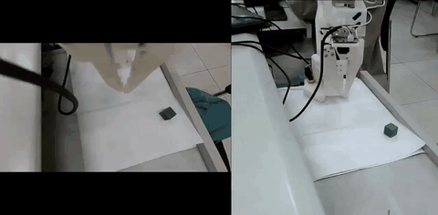
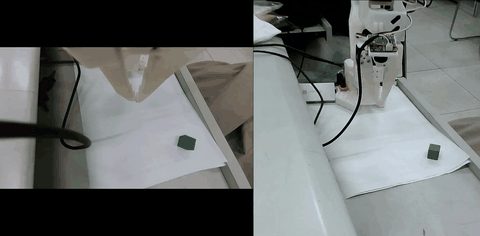
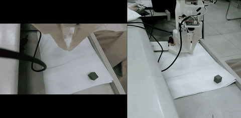
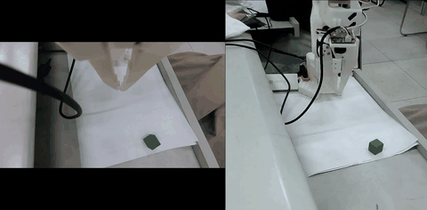
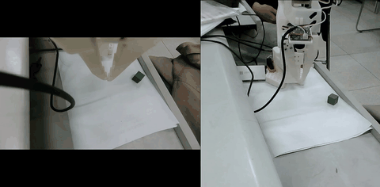
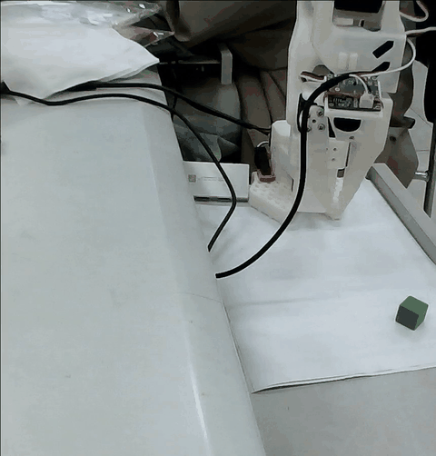
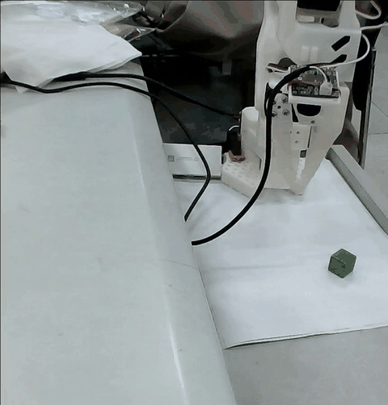

# SO-101 真机抓放：脚本技能 + π0.5 末端策略 + Qwen3-VL 判官

在 SO-101 六轴机械臂上跑通真机抓取—放置：脚本负责几何对轴，π0.5 LoRA 接管末段，Qwen3-VL 在合爪前做否决。无人值守采集 6 小时产出 120 条、有效率 68%；加入 VLA 末段后单趟平均 100 s → 43 s，抓取成功率 83%。

## 1. 项目简介

这是一个真机抓取 harness，不是只跑仿真的 demo。它把一条抓取拆成五个可替换的零件：机械臂、相机、策略、判官、技能；主循环只认接口，换实现只改 `configs/` 里一行。

核心取舍是「脚本保底、模型只接一小段」：

- 脚本技能负责可解释的部分：回位、悬停、转腕对轴、下探、合爪、抬升、放置。
- π0.5 只接最后一段（横向对齐、下探、合爪）；模型只出动作，成败仍由脚本判。
- Qwen3-VL 只做合爪前的否决，不指挥机械臂，也不参与轮末成败判定。
- 失败按失败码归因，三档策略按码路由；失败样本回流成 VLM 判官的训练对。

同一套接口也能在 MuJoCo 里跑（`run_sim.py`），用于对照脚本策略和仿真真值判官。

## 2. 核心结果

| 维度 | 结果 |
|---|---|
| 数据采集 | 4 Hz、腕 + 侧双相机；无人值守连续采集 6 小时，产出 120 条，有效率 68% |
| 失败归因 | 7 类失败码：`off_axis` / `too_low` / `too_high` / `no_gap` / `slip` / `descend_fail` / `other` |
| 末端策略 | π0.5 LoRA（仅 adapter，`action_horizon=10`） |
| 端到端 | 脚本对轴 + π0.5 接管末段（下探 / 横向对齐 / 合爪）：单趟平均 100 s → 43 s，抓取成功率 83% |
| 策略路由 | 三档 `oneshot` / `full` / `vla_end`，按失败码自动路由 |
| VLM 判官 | Qwen3-VL LoRA r16/α32；6 类失败场景 300 条成对训练，280 条评测二分类准确率 92.9% |

表中的端到端时间、成功率、采集条数和有效率来自真机实测记录；其余数字可以在代码与配置里对到。有效率 = 判 `held` 并写进数据集的集数占全部采集集数的比例；没抓成的整集丢弃。

## 3. 方法与流水线

### 3.1 五接口

主循环只认五块：臂、相机、策略、判官、技能。代码里感知也单独成接口（`Perceptor`，跟着相机这一块装配），所以 `core/interfaces.py` 实际有 6 个抽象基类。

| 零件 | 职责 | 现有实现 |
|---|---|---|
| 机械臂 `Arm` | 动：读 TCP、朝目标走一小步、读关节角/接触 | `impls/arm_sim.py`、`real/arm.py` |
| 相机 `Camera` / 感知 `Perceptor` | 看：给一帧、给尺寸、给机位/内参；认：按指令找目标并给出世界坐标 | `impls/cam_sim.py`、`real/cameras.py`、`real/side_cam.py`；`impls/perception.py`、`real/perception.py` |
| 策略 `Policy` | 决定顺序：一次给一串动作 | `impls/policy_expert.py`、`impls/policy_real.py` |
| 判官 `Judge` | 轮末判成败 | `impls/judge_truth.py`、`impls/judge_grasp.py`、`impls/judge_held.py` |
| 技能 `Skill` | 干一件小事：抓/放/回位/安全检查 | `skills/pick.py`、`skills/pick_real/` |

装配由 `core/registry.py` 的「名字 → 类」表和 `configs/*.yaml` 完成。换实现只改配置里那一行。

### 3.2 一次抓取的执行顺序

```
腕相机 / 侧相机
      │
      ▼
感知：HSV 找目标色块 → 矩形度过滤 → 内参 + 手眼反投影 → 中心 / 朝向 / 尺寸
      │
      ▼
脚本技能：回位 → 悬停 → 转腕对轴 → 竖直下探 → 合爪 → 抬升 → 放置
      │                                   │
      │                                   └─ vla_end：下探 / 横向对齐 / 合爪交给 π0.5
      ▼
判官：6 号舵机角度（held / empty） + 轮末 Judge
```

1. 回初始位：`home_real` 把六轴回到 `real_home.RAW_HOME`，腕相机正对桌面。
2. 看一眼：`real/perception.py` 用 HSV 找目标色块，用矩形填充率过滤同色杂物；`core/vision.py` 用相机内参和手眼标定把像素反推到基座系，估中心、朝向和尺寸。
3. 进场与转腕：`skills/pick_real/motion.py` 走到悬停点；`align.py` 把合爪轴（工具 x 轴）转到方块侧面法向。
4. 对轴下探：`rulers.py` 同时看画面缝宽和 3D 离轴；`decide.py` 用上一趟实测的「扎过头多少」修正这一趟终点；`motion.py` 走竖直一截。`vla_end` 档这一步交给 π0.5。
5. 合爪与判夹：`grasp.py` 合到压不动；`grasp_check.py` 读 6 号舵机角度，和本趟现测的空抓基准比，判 `held` / `empty`。`vla_end` 档由模型合爪，但判据仍走这里。
6. 抬升与放置：抬到搬运高度；抓成后按坐标放到随机点，给下一集换位置，再回初始位。
7. 安全闸：每一步自动走位前后都过 `real/safety.py`；越界立 `terminated`，这一集作废。

### 3.3 三档策略与失败码路由

`configs/strategies.json` 是策略的唯一来源。三档不是三份技能，而是同一份 `pick_real` 的三组参数覆盖：

| 档 | 脚本做什么 | 典型使用 |
|---|---|---|
| `oneshot` | 跳过合爪前微调，固定爪尖直接到计算落点 | 默认；`too_low` |
| `full` | 画面雅可比微调 + 中心 −1 mm | `off_axis` / `no_gap` / `slip` / `too_high` / `descend_fail` |
| `vla_end` | 脚本只到「腕子对上方块侧面」，下探、横向对齐、合爪交给 π0.5 | 需要 VLA 末段时 |

失败码到下一档的映射：

| 失败码 | 典型含义 | 下一档 |
|---|---|---|
| `off_axis` | 合爪轴偏离 | `full` |
| `too_low` | 下探过深 | `oneshot` |
| `too_high` | 下探过浅 | `full` |
| `no_gap` | 爪面没有缝 | `full` |
| `slip` | 没夹住 / 抬起来掉了 | `full`；同一档先按实测再扎一趟 |
| `descend_fail` | 下探没走成 | `full` |
| `other` | 其他 | 按阶梯取未试过的一档；都试过就停 |

`no_detect`（没认出来）是停止条件，不进重试。路由代码在 `skills/pick_real/strategy.py::code()` / `next_after()`；面板的连续抓取用它换档。

无人值守采集另有 `ppo/policy.py` 的重试账本：`baseline` / `no_measure` / `full` 三组参数，每次只换一个变量，全部试过后回到实测开口最大的一档。它只吃技能交回的实测数，不碰硬件。

### 3.4 π0.5 末端策略

π0.5 只做末段。观测是腕相机 + 侧相机两路图，动作是 6 个关节的目标角，一次输出 10 步的 action chunk（`action_horizon=10`）。训练只更新 LoRA adapter（`gemma_2b_lora` + `gemma_300m_lora`），基座权重冻结。

有两个接入点：

- 策略表里的 `vla_end`：脚本完成「认方块 → 搬过去 → 腕子对上方块侧面」后接入，模型做下探、横向对齐、合爪。
- 环境变量 `PICK_VLA_END=1`（旧入口）：脚本下探到底之后再接入，模型做横向纠偏、最后竖直一截、合爪。

两条都由 `_close_and_lift(already_closed=True)` 判夹没夹住。客户端在 `_pi05_run.py` 和 `_pi05_link.py`；`skills/pick_real/vla_end.py` 负责把技能接到模型上。策略服务跑在外部 GPU 上，本机只做端口转发。

### 3.5 Qwen3-VL 判官

它不是轮末的 `Judge`，而是合爪前的一次否决闸：下探到位、合爪之前，把当前帧和一张下探前参考帧交给 Qwen3-VL，问「方块还在两爪之间吗」。同一组图问两次，两次一致才算数；只有 `no` 触发「抬回悬停点、重下一次」，`yes` / `unsure` / 超时一律放行。

它不改档位、不给偏移、不碰关节；一集仍然只合一趟爪。代码在 `ppo/vlm.py::judge`，接线在 `skills/pick_real/vlm_gate.py`；采集脚本默认接上，`--no-vlm-judge` 可关闭。

### 3.6 无人值守采集与安全闸

`collect_real_dataset.py` 的一集是：回家（不录）→ `pick_real` 走一趟（录）→ 判 `held` 才写盘。没抓成的整集丢掉，但失败码、原图、实测数留在 `out/` 供归因。抓成后技能自己把方块摆到随机点，给下一集换位置。

停止只走 `out/STOP` 文件，避免硬杀进程截断 parquet。`out/` 每次启动会按天数清理。

安全闸的阈值都按实测取：单步单关节 45°、TCP 包络半径 300 mm / z −30~200 mm、2 号肩抬 ≥ −45°、3 号肘两臂夹角 ≥ 75°。触发即停手，这一集作废；现场交 VLM 存档，随后回初始位继续下一集。

## 4. 目录结构

```
so101-real-harness/
├─ core/                    五接口、记录/注册表、几何/视觉/轨迹
│  ├─ interfaces.py         Arm / Camera / Perceptor / Policy / Judge / Skill
│  ├─ types.py              Round / Verdict（一轮唯一记录形状）
│  ├─ registry.py           名字 → 实现
│  ├─ follow.py             笛卡尔跟踪
│  ├─ trajectory.py         toppra 时间最优轨迹
│  ├─ geom.py / shapes.py   工位几何、形状表
│  ├─ vision.py             从腕相机量位置/朝向
│  ├─ params.py             速度/高度/夹持力参数
│  ├─ round_state.py        一轮内技能间共享状态
│  └─ blind.py              仿真盲测
├─ impls/                   接口的仿真/真机实现
│  ├─ arm_sim.py / cam_sim.py
│  ├─ arm_sim_real.py       真机代码跑在仿真臂上
│  ├─ perception.py
│  ├─ policy_expert.py / policy_real.py
│  └─ judge_truth.py / judge_grasp.py / judge_held.py
├─ skills/                  小模块
│  ├─ pick.py / place.py / home.py / sweep.py   仿真技能
│  └─ pick_real/            真机抓取技能：编排、运动、对齐、合爪、失败码、策略
├─ panel/                   tkinter 真机面板：画面、按钮、断点、连续采集
├─ real/                    真机硬件层：串口臂、相机、感知、录制、安全闸、侧相机
├─ ppo/                     重试账本、定位守卫、VLM 诊断/判官
├─ configs/                 装配配置（default / real / sim_real）+ 三档策略表
├─ assets/                  相机标定、标定板
├─ docs/                    接口说明、面试论文清单、演示媒体
├─ datasets/                LeRobot 数据集（按环境生成，不随仓库发布）
├─ collect_real_dataset.py  真机无人值守采集入口
├─ run_sim.py               MuJoCo 主循环入口
├─ _pi05_run.py             π0.5 推理入口
├─ _vla_end_try.py          脚本 + π0.5 末段的一趟演示
├─ servo_bridge.py          Feetech 舵机驱动桥
├─ real_home.py             真机初始点位
├─ grasp_check.py           6 号舵机夹持判据
└─ thresholds.json          HSV / 夹爪阈值
```

## 5. 环境依赖

### 软件

开发环境是 Windows 10/11 + Python 3.12。主要依赖：

- `numpy`、`opencv-python`、`scipy`、`toppra`、`mujoco`、`PyYAML`、`Pillow`
- `lerobot==0.6.1`（数据集读写）
- `websockets` + `openpi_client`（π0.5 客户端）
- `pyserial`（Feetech 总线，经外部驱动）
- `so101_nexus`（运动学、归一化和 MuJoCo 抓取环境）
- `tkinter`（Windows Python 自带，面板用）
- `pandas`、`pyav`（只在切数据集/统计时用）
- `paramiko`（只在 SSH 端口转发脚本里用）
- `torch` / `transformers` / `ms-swift`（只在 Qwen3-VL 训练/部署时用）

仓库的 `requirements.txt` 列出主循环所需依赖；`openpi_client`、`so101_nexus`、Qwen3-VL 权重不在 PyPI，按下一节的说明单独准备。

### 外部仓库与模型

以下都不在本仓库内，路径需要按环境配置：

- `SO-ARM100` 的 MuJoCo 模型 `so101_new_calib.xml`：`real/arm.py` 用它做正解。
- Feetech 舵机驱动 `servo_control_standalone.py`：`servo_bridge.py` 把它加进 `sys.path`。
- `so101_nexus`：仿真环境和运动学工具。
- openpi：π0.5 策略服务；仓库只含客户端。
- Qwen3-VL + ms-swift：判官训练和 OpenAI 兼容部署。

### 硬件

- SO-101 从臂，6 个 Feetech SCS 舵机，USB 串口总线。
- 腕部 USB 相机（原生 1920×1080；数据里存 960×540）。
- 可选侧视 USB 相机：只进数据、不参与抓取；双相机数据集需要它。
- π0.5 和 Qwen3-VL 需要外部 GPU；本地脚本和面板不需要 GPU。

## 6. 如何运行

以下命令都在仓库根目录执行；`python` 指装有上述依赖的解释器。

### 6.1 仿真自检

```bash
python run_sim.py --config configs/default.yaml --rounds 2 --seed 0
```

默认配置用 `siglip2` 感知；没有模型权重时，把 `configs/default.yaml` 的 `perception` 改成 `nearest`（不依赖模型）。仿真需要 `so101_nexus` 和 `SO-ARM100` 模型路径可用。

### 6.2 真机面板

```bash
python -m panel
```

面板是一个原生 tkinter 窗口：左侧腕相机画面、右侧按钮和读数。F1 跑一趟，F6 开关连续采集。串口、相机序号、桌面高度、感知偏移都在 `configs/real.yaml` 里，按机器修改。

```bash
python -m panel --collect
```

开窗就开始自动采集。

### 6.3 无人值守采集

```bash
python collect_real_dataset.py --episodes 10 --root datasets/so101_real_grasp_2cam_4hz --repo-id so101_real/pick_grasp_2cam
```

`--episodes 0` 表示不设上限；`--dry-run` 只跑不写盘；`--no-vlm-judge` 关闭合爪前的 Qwen 判官。

### 6.4 π0.5 末段

先启动外部策略服务并做本机端口转发，然后：

```bash
python _pi05_run.py --steps 200 --hz 4
```

只让 π0.5 驱动整段。要跑「脚本对轴 + π0.5 接管末段」的一趟：

```bash
python _vla_end_try.py
```

`configs/strategies.json` 里的 `vla_end` 就是这条路的策略条目。

### 6.5 标定

- 内参 + 手眼：`real/calib_views.py` 采视图，`real/mount_check.py` 用 ChArUco 验反投影。
- 颜色 / 夹爪阈值：`calibrate_color.py`、`calibrate_grasp.py` 写 `thresholds.json`。
- 工位常数：`configs/real.yaml` 的 `table_z_mm`、`pick_xy_mm`、`percep_offset_mm`，换桌面或换相机后要重量。

## 7. 数据与训练

### 7.1 数据集格式

采集写 LeRobot v3.0（`lerobot 0.6.1`）：

- `observation.state` / `action`：6 维，关节角（度，0~180 舵机口径），顺序 `shoulder_pan, shoulder_lift, elbow_flex, wrist_flex, wrist_roll, gripper`。
- `observation.images.camera1`：腕相机，960×540。
- `observation.images.camera2`：侧相机（配置了侧相机时才有）。
- `task`：每帧一句，来自 `configs/real.yaml` 里的目标颜色。
- `fps=4`：0.2 s 的采样闸口隔一步录一帧。

只录抓取那一段：夹爪标定段和摆件段不录；抓成（`held` 且没掉）的集才写盘。无人值守那轮 6 小时产出 120 条，有效率 68%。

### 7.2 π0.5 LoRA

- 切末段：`_build_endseg.py` 从 6 号舵机第一次读到 >15° 的前 2 帧切到集尾；262 集实测中位 28 帧/集。丢掉 ep 0~19，因为那 20 集张到 99~100°，和现役 20° 上限不是同一套。
- 训练配置：`pi05=True`、`action_horizon=10`、`paligemma_variant=gemma_2b_lora`、`action_expert_variant=gemma_300m_lora`、20k steps、恒定 lr 1e-5、batch 2；只训 LoRA adapter。
- 配置片段在 `_add_endseg_cfg.py`、`_add_v2_cfg.py`，启动脚本在 `_train_pi05_v2.sh`。这些脚本里的路径是云端环境专用，公开前按环境改。

### 7.3 Qwen3-VL 判官

- 数据：`_build_vlm_sft.py` 把成败样本做成成对图（合爪前 + 当前），标签来自 6 号舵机合爪角（`held` = 方块顶住，`empty` = 合到底）。
- 规模：6 类失败场景，300 条成对样本训练；280 条评测样本上二分类准确率 92.9%。
- 模型：Qwen3-VL-4B-Instruct + LoRA（rank 16、alpha 32）。
- 部署：ms-swift 起 OpenAI 兼容端点，`ppo/vlm.py::judge` 通过 `VLM_JUDGE_BASE_URL` 接入。

### 7.4 复现说明

数据集、模型权重、训练日志都不在本仓库。`datasets/` 和 `out/` 由采集/训练脚本按环境生成；`configs/real.yaml` 里的数据集根目录、串口、相机序号是现场值。

## 8. 演示媒体

下面是 GIF 预览，会直接在 README 里循环播放；每行末尾有对应的完整 mp4。

### 无人值守连续采集

| 预览 | 这一段发生了什么 |
|---|---|
|  | **一趟完整抓放（15 秒原速）**：从初始位找到方块，转腕对轴、竖直下探、合爪、抬到目标点后松开。[完整 mp4](docs/media/videos/00-unattended-15s.mp4) |
|  | **连续多趟（23 分钟压到 8 倍速）**：抓完自动把方块摆到下一个位置、回零再来；没抓成的趟也会回零重试。[完整 mp4](docs/media/videos/01-unattended-23min-8x.mp4) |

### 脚本三档

| 预览 | 这一段发生了什么 |
|---|---|
|  | **一步到位**：合爪前不做微调，爪尖直接到由方块中心算出的落点，竖直下扎、合爪、抬起。[完整 mp4](docs/media/videos/02-script-oneshot.mp4) |
|  | **先量一眼**：下探前先在腕相机里量爪面到方块的缝，按这一眼的实测把落点修正后再下扎。[完整 mp4](docs/media/videos/03-script-measure-once.mp4) |
|  | **完整微调**：合爪前用画面雅可比反复小幅平移，把方块推回两爪正中间再合爪。[完整 mp4](docs/media/videos/04-script-full-finetune.mp4) |
|  | **多轮微调**：同一个落点连续纠偏多次，展示画面闭环在偏差较大时的收敛过程。[完整 mp4](docs/media/videos/05-script-finetune-multi.mp4) |

### VLA 末段

| 预览 | 这一段发生了什么 |
|---|---|
|  | **腕部对齐后交给 π0.5**：脚本先把腕子转到方块侧面的法向，π0.5 从这一帧接管下探、横向对齐和合爪。[完整 mp4](docs/media/videos/06-vla-handover.mp4) |
|  | **模型先夹空再重夹**：π0.5 第一次合爪夹空，6 号舵机判定为 empty 后抬回悬停点，第二次下扎才夹住。[完整 mp4](docs/media/videos/07-vla-retry.mp4) |

## 9. 已知边界

- 真机常数强依赖现场：串口、相机序号、桌面高度、感知偏移、初始舵机原始值分别在 `configs/real.yaml`、`real_home.py`、`assets/` 里，换一台机器要重新标定。
- Qwen3-VL 判官只覆盖「合爪前方块在不在两爪之间」；合爪后的滑落不在它的判据里。
- π0.5 的策略服务在外部 GPU，仓库只含客户端和末段接线，不能单独起模型。
- 真机面板一次跑一趟默认只合一次爪（`max_attempts: 1`）；重试由无人值守采集的 `ppo/policy.py` 或面板的策略阶梯负责，不靠原样重放。
- 数据集、权重、日志不随仓库发布。